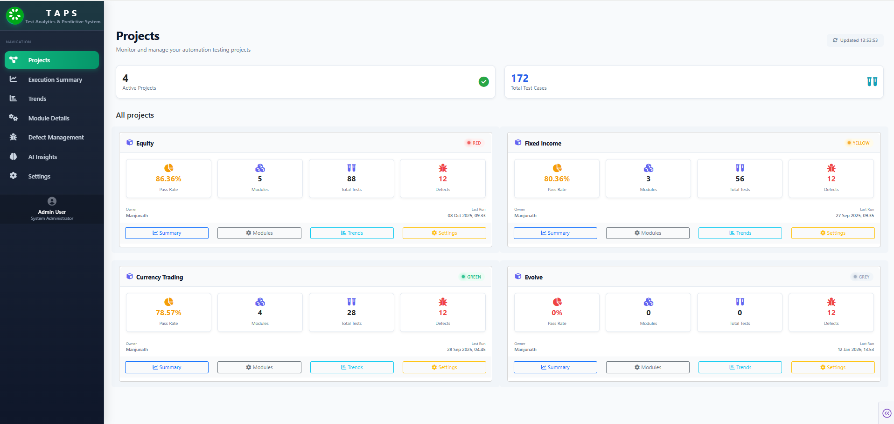
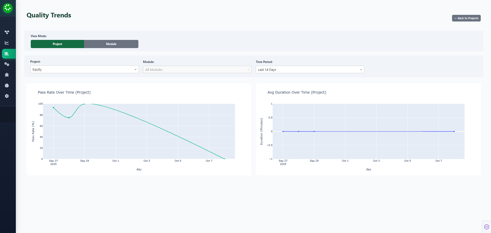
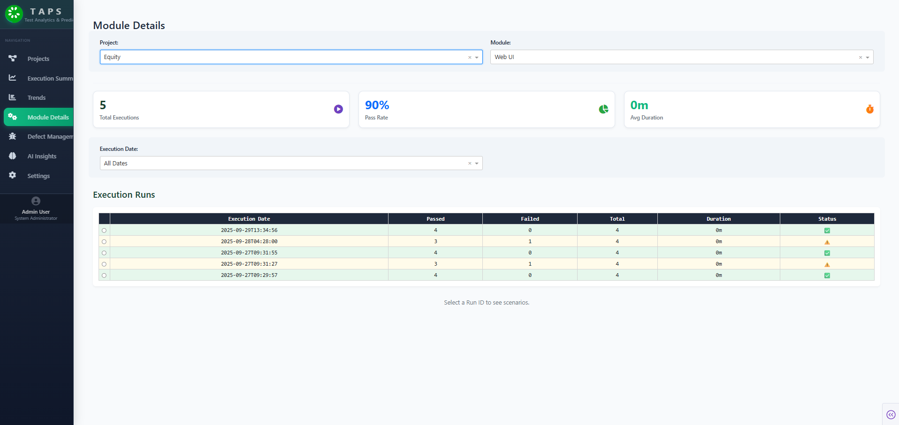

# test-analytics-portal

`
git clone <url>
`
`
python -m venv venv
`
`
naviaget venv -> Scripts -> activate
`
`
pip install -r requirements.txt
`

#### Command to start Dash frontend

`
python ui/dashboard.py
`

#### Command to start uvicorn backend

`python -m uvicorn service.main:app --reload --host 0.0.0.0 --port 8000
`

