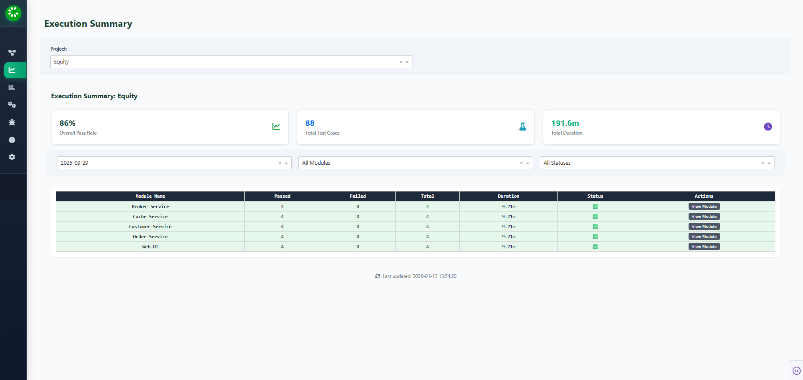
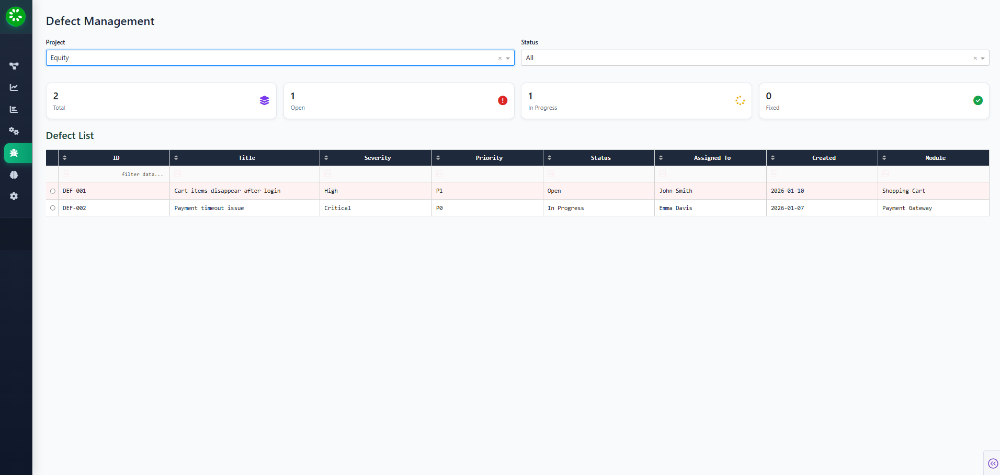
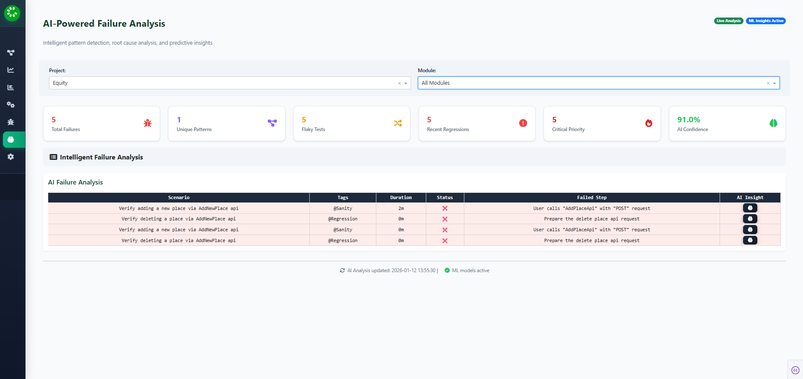
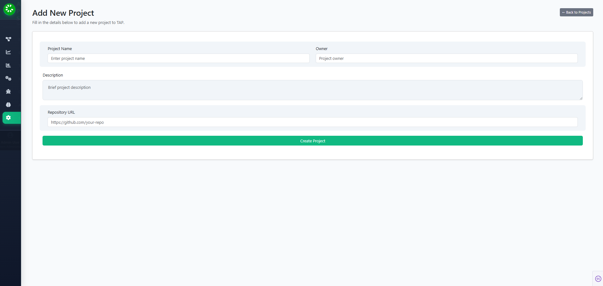

# Test Analytics Portal (TAPS)

**Test Analytics & Predictive System** - A comprehensive web-based platform for analyzing, monitoring, and managing
automated test execution results with AI-powered insights.

## 🎯 What is Test Analytics Portal?

The Test Analytics Portal is a powerful testing intelligence platform designed to transform raw test execution data into
actionable insights. It provides development and QA teams with comprehensive analytics, trend analysis, and predictive
capabilities to improve software quality and testing efficiency.

### Key Features

🔍 **Comprehensive Test Analytics**

- Real-time test execution monitoring and reporting
- Historical trend analysis with customizable time periods
- Pass rate calculations and quality metrics tracking
- Module-level and project-level performance insights

📊 **Interactive Dashboard**

- Modern, responsive web interface built with Dash and Bootstrap
- Project overview with status indicators and KPI cards
- Execution summary tables with filtering and sorting capabilities
- Visual trend charts for pass rates and execution duration

🤖 **AI-Powered Insights**

- Intelligent failure analysis and pattern recognition
- Predictive analytics for test stability and quality trends
- Automated defect categorization and root cause analysis
- Smart recommendations for test optimization

⚙️ **Multi-Format Support**

- Native Cucumber JSON report parsing and processing
- RESTful API for integration with CI/CD pipelines
- Support for multiple testing frameworks and tools
- Extensible architecture for custom report formats

🎛️ **Advanced Management**

- Project and module organization with hierarchical structure
- User management and access control
- Configurable settings and preferences
- Export capabilities for reports and analytics

## 🚀 Benefits

### For Development Teams

- **Faster Feedback Loops**: Get immediate insights into test failures and quality trends
- **Data-Driven Decisions**: Make informed choices about release readiness and code quality
- **Reduced Investigation Time**: AI-powered failure analysis speeds up debugging
- **Quality Visibility**: Clear metrics and trends help maintain high code quality standards

### For QA Teams

- **Centralized Test Management**: Single source of truth for all test execution data
- **Trend Analysis**: Identify patterns in test failures and stability issues
- **Efficiency Tracking**: Monitor test execution performance and optimization opportunities
- **Automated Reporting**: Generate comprehensive reports for stakeholders

### For Management

- **Quality Metrics**: Real-time visibility into product quality and testing effectiveness
- **Resource Optimization**: Identify bottlenecks and areas for process improvement
- **Risk Assessment**: Predictive analytics help assess release risks
- **ROI Tracking**: Measure the impact of testing investments on quality outcomes

## 🏗️ Architecture

**Backend (FastAPI + SQLAlchemy)**

- High-performance REST API with async support
- SQLite/PostgreSQL database for scalable data storage
- Modular service architecture with clean separation of concerns
- Comprehensive API documentation with OpenAPI/Swagger

**Frontend (Dash + Plotly)**

- Interactive web dashboard with real-time updates
- Responsive design optimized for desktop and mobile
- Rich data visualizations and charts
- Component-based architecture for maintainability

**Data Processing**

- Intelligent Cucumber JSON parser with scenario-level metrics
- Real-time data aggregation and analytics
- Flexible schema supporting multiple test frameworks
- Automated data validation and error handling

## 🛠️ Installation & Setup

### Prerequisites

- Python 3.8 or higher
- Git for version control
- Modern web browser (Chrome, Firefox, Safari, Edge)

### Quick Start

1. **Clone the Repository**
   ```bash
   git clone <repository-url>
   cd test-analytics-portal
   ```

2. **Set Up Virtual Environment**
   ```bash
   python -m venv venv
   ```

3. **Activate Virtual Environment**

   **Windows:**
   ```bash
   venv\Scripts\activate
   ```

   **macOS/Linux:**
   ```bash
   source venv/bin/activate
   ```

4. **Install Dependencies**
   ```bash
   pip install -r requirements.txt
   ```

5. **Start the Backend API Server**
   ```bash
   python -m uvicorn service.main:app --reload --host 0.0.0.0 --port 8000
   ```

   The API will be available at: `http://localhost:8000`

   API Documentation: `http://localhost:8000/docs`

6. **Start the Frontend Dashboard**

```bash
python ui/dashboard.py
```

The dashboard will be available at: `http://localhost:8050`

### Alternative: Docker Compose Setup

For a containerized deployment, you can use Docker Compose to start both the backend and frontend services:

```bash
docker-compose up -d
```

This will start:

- Backend API server at: `http://localhost:8000`
- Frontend dashboard at: `http://localhost:8050`

To stop the services:

```bash
docker-compose down
```

## 📱 User Interface Overview

### Projects Dashboard


*Comprehensive project overview with status indicators, KPIs, and quick actions*

### Execution Summary


*Detailed test execution results with filtering, sorting, and drill-down capabilities*

### Trend Analysis


*Visual trend analysis for pass rates, duration, and quality metrics over time*

### Module Details


*Module-level insights and performance metrics for granular analysis*

### Defect Management


*Integrated defect tracking and management with automated categorization*

### AI-Powered Analysis


*Intelligent failure analysis with pattern recognition and predictive insights*

### Settings & Configuration


*Customizable settings for projects, users, and system configuration*

## 🔌 API Integration

### Upload Test Results

```bash
curl -X POST "http://localhost:8000/api/reports/upload" \
     -F "project_name=MyProject" \
     -F "module_name=LoginTests" \
     -F "file=@cucumber-report.json"
```

### Fetch Project Data

```bash
curl "http://localhost:8000/projects/all_projects"
```

### Get Execution Summary

```bash
curl "http://localhost:8000/api/executions/project/{project_id}"
```